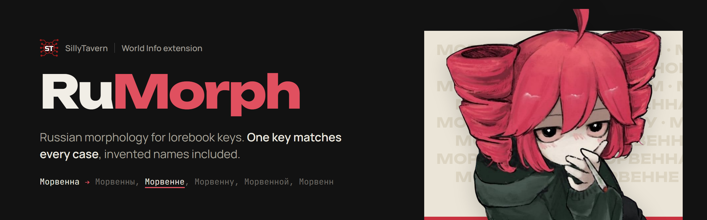

<p align="center">
  
</p>

<p align="center">
  <a href="https://github.com/safdafang/SillyTavern-RuMorph/actions/workflows/test.yml"></a>
  <a href="https://github.com/SillyTavern/SillyTavern"></a>
  <a href="#licence"></a>
  <a href="README.ru.md"></a>
</p>

A [SillyTavern](https://github.com/SillyTavern/SillyTavern) extension that makes World Info keys
understand Russian inflection. A key `Морвенна` fires on «подошёл к Морвенне», `тёмный лес` fires on
«в тёмном лесу», and `кот` no longer fires on «котлета». Everything runs in the browser, no server
plugin required.

> [!NOTE]
> RuMorph is a community extension and is not affiliated with the SillyTavern team.

## Why

SillyTavern matches lorebook keys as plain substrings. A Russian noun has a dozen forms, so lorebook
authors end up listing every case by hand or writing regular expressions.

| Key | Chat message | SillyTavern | With RuMorph |
|---|---|:---:|:---:|
| `Морвенна` | Я подошёл к Морвенне | no match | match |
| `тёмный лес` | Мы заблудились в тёмном лесу | no match | match |
| `Элдрин` | Поговори с Элдрином | no match | match |
| `кот` | На столе лежала котлета | false match | no match |

"Match Whole Words" does not help with Cyrillic either. `WorldInfoBuffer.matchKeys` builds
`(?:^|\W)key(?:$|\W)` without the `u` flag, and in JavaScript `\W` then treats every Cyrillic letter
as a non-word character. RuMorph uses Unicode boundaries, `(?<![\p{L}\p{N}])…(?![\p{L}\p{N}])` with `u`.

## Features

* **Dictionary words.** Full lexemes from the [OpenCorpora](http://opencorpora.org/) dictionary via
  [Az.js](https://github.com/deNULL/Az.js): all cases including the second genitive and locative
  («в лесу»), `-ою` variants, singular and plural.
* **Invented names.** A single dictionary guess is not trusted (Az.js calls «Морвенна» masculine).
  RuMorph takes the union of every paradigm that fits the ending, with Russian spelling rules and
  fleeting vowels. An invented stem is unique, so extra forms cost nothing.
* **Phrases.** Adjectives agree with the noun in gender, number and animacy («тёмного леса», «вижу
  чёрного кота»), name chains decline together («Киры Морвенны»), genitive dependents stay as written
  («Ордену Серебряного Клинка»), hyphenated names are supported.
* **Manual hints.** Gender, indeclinable, extra forms and forms to exclude, per word.
* **Compile mode.** Bakes the generated keys into a lorebook file, so it works for people without the
  extension. Original keys are kept and can be restored.
* **Preview.** Type a key, see every form, the resulting regex and a phrase tester.
* **Safe by default.** Saved lorebooks are never modified at runtime, regex keys, `{{macros}}` and
  Latin keys are left alone, and any failure leaves the keys unchanged instead of breaking the scan.

## Installation

Requires SillyTavern 1.13.2 or newer.

1. Open **Extensions** and choose **Install extension**.
2. Paste `https://github.com/safdafang/SillyTavern-RuMorph` and install.
3. Settings appear under **Extensions → RuMorph**. The dictionaries (about 11 MB) load in the
   background on first start.

Both installation modes work: for the current user (`data/<user>/extensions`) and for all users
(`public/scripts/extensions/third-party`).

## Usage

RuMorph works as soon as it is installed. Before every World Info scan SillyTavern emits
`WORLDINFO_ENTRIES_LOADED` with copies of the entries, and RuMorph replaces each Cyrillic key in those
copies with a regex that lists all its forms:

```text
/(?<![\p{L}\p{N}])(?:Морвеннами|Морвеннам|Морвеннах|Морвенной|Морвенною|Морвенна|Морвенне|Морвенну|Морвенны|Морвенн)(?![\p{L}\p{N}])/iu
```

`е` and `ё` are interchangeable, spaces between words match any whitespace, and the `i` flag is set
unless the entry is case sensitive.

### Settings

| Option | Default | Effect |
|---|---|---|
| Enabled | on | Turns runtime expansion on and off. |
| Strict word boundaries | on | Unicode boundaries for every key. When off, boundaries are used only for entries with Match Whole Words. |
| Minimum word length to inflect | 3 | Shorter words keep their form but still get boundaries, so `ум` does not fire on «умный». |

### Hints

Type a key into the preview, then set a hint for it. For example, «Элдрин» with gender *feminine*
becomes indeclinable («с Элдрин»), and an extra form adds a nickname such as «Морви». Hints are stored
in the extension settings and apply to every key that contains the word.

### Compile mode

Pick a lorebook and press **Compile**. RuMorph shows how many entries will change and, after
confirmation, writes the regex keys into the file. The originals are stored in
`entry.extensions.rumorph.originalKeys`, which SillyTavern keeps on save, export and when embedding a
lorebook into a character card. **Restore** puts them back. Compiling again rebuilds the keys from the
originals, so new hints are picked up.

### Slash command

```text
/rumorph Морвенна
/rumorph format=regex тёмный лес
/rumorph format=json Кира Морвенна
```

## Limitations

* Keys with macros such as `{{char}}` are not expanded: SillyTavern substitutes them after the event.
* SillyTavern tracks timed effects (sticky, cooldown, delay) by a hash of the entry, keys included.
  Output is deterministic, so the hash is stable while RuMorph is on, but turning the extension on or
  off in the middle of a chat, or changing a hint, resets running timers.
* A generated form can coincide with an ordinary word («Мора» and «море»). Plural forms of proper
  names that are dictionary words in their own right are dropped, and so are colloquial vocatives
  («Свет!»). Anything else can be excluded with a hint.
* Stress is unknown, so both spellings are generated after hushing consonants («Мишей» and «Мишой»).
* Verbs and adverbs keep their form and only get word boundaries.
* If the dictionaries are not loaded within 5 seconds of the first generation, keys are used as they
  are for that generation and a single warning is shown.

## Performance

Measured with `npm run bench` on Node 24, lorebook of 1000 entries with 5 keys each (1246 unique keys:
dictionary words, invented names and phrases).

| | Time |
|---|---|
| Loading Az.js and the dictionaries | 125 ms |
| First pass, empty cache | 1.7 s, about 1.4 ms per unique key |
| Every following pass | 1.3 ms median |
| Pass after a hint change | 11 ms |

Results are cached in memory and in IndexedDB, and keys of an edited lorebook are computed in idle time.

## Development

```console
npm test                       # node:test, no install needed
npm run bench
node scripts/i18n-check.mjs
npm install && npm run vendor  # refresh vendor/az and dicts from the az package
```

Every match assertion goes through `test/st-matchkeys.js`, a copy of `WorldInfoBuffer.matchKeys` from
SillyTavern. The integration tests reproduce `getSortedEntries()`, including the fact that on a cache
miss SillyTavern hands out key arrays shared with the cached lorebook, which is why RuMorph always
assigns new arrays instead of editing them in place.

Az.js is loaded with a `<script>` tag resolved from `import.meta.url`: the build is UMD, there is no
bundler step, and the code in the repository is exactly the code that runs.

## Licence

RuMorph is released under the [GNU AGPL 3.0](LICENSE).

Bundled third party components:

* [Az.js](https://github.com/deNULL/Az.js) 0.2.3, MIT licence, see [vendor/az/LICENSE](vendor/az/LICENSE).
* OpenCorpora dictionaries compiled by [pymorphy2-dicts](https://github.com/kmike/pymorphy2-dicts),
  CC BY-SA 3.0, see [dicts/LICENSE](dicts/LICENSE). Distributed unmodified.

The SillyTavern logo in the banner belongs to the SillyTavern project. Kasane Teto is a character by TWINDRILL, the illustration belongs to its artist.
