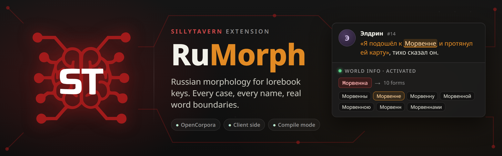

<p align="center">
  
</p>

<p align="center">
  <a href="https://github.com/safdafang/SillyTavern-RuMorph/actions/workflows/test.yml"></a>
  <a href="https://github.com/SillyTavern/SillyTavern"></a>
  <a href="#лицензия"></a>
  <a href="README.md"></a>
</p>

Расширение для [SillyTavern](https://github.com/SillyTavern/SillyTavern), которое учит ключи лорбука
(World Info) понимать падежи. Ключ `Морвенна` срабатывает на «подошёл к Морвенне», `тёмный лес` на
«в тёмном лесу», а `кот` больше не срабатывает на «котлета». Всё работает в браузере, серверный плагин
не нужен.

> [!NOTE]
> RuMorph сделан сообществом и не связан с командой SillyTavern.

## Зачем

SillyTavern ищет ключи лорбука как обычную подстроку. У русского существительного около дюжины форм,
поэтому авторам лорбуков приходится перечислять все падежи вручную или писать регулярные выражения.

| Ключ | Сообщение в чате | SillyTavern | С RuMorph |
|---|---|:---:|:---:|
| `Морвенна` | Я подошёл к Морвенне | не срабатывает | срабатывает |
| `тёмный лес` | Мы заблудились в тёмном лесу | не срабатывает | срабатывает |
| `Элдрин` | Поговори с Элдрином | не срабатывает | срабатывает |
| `кот` | На столе лежала котлета | ложное срабатывание | не срабатывает |

Режим «Match Whole Words» с кириллицей тоже не помогает. `WorldInfoBuffer.matchKeys` строит
`(?:^|\W)ключ(?:$|\W)` без флага `u`, а без него `\W` в JavaScript считает любую кириллическую букву
«не буквой». RuMorph ставит Юникод-границы `(?<![\p{L}\p{N}])…(?![\p{L}\p{N}])` с флагом `u`.

## Возможности

* **Словарные слова.** Полные лексемы из словаря [OpenCorpora](http://opencorpora.org/) через
  [Az.js](https://github.com/deNULL/Az.js): все падежи, включая второй родительный и предложный
  («в лесу»), формы на `-ою`, единственное и множественное число.
* **Выдуманные имена.** Одной догадке словаря RuMorph не доверяет (Az.js считает «Морвенну» мужским
  родом), а берёт объединение всех парадигм, подходящих под окончание, с учётом орфографии и беглых
  гласных. Основа выдуманного имени уникальна, поэтому лишние формы ничего не ломают.
* **Словосочетания.** Прилагательное согласуется с существительным по роду, числу и одушевлённости
  («тёмного леса», «вижу чёрного кота»), цепочки имён склоняются вместе («Киры Морвенны»), зависимые
  слова в родительном падеже не меняются («Ордену Серебряного Клинка»), поддерживаются имена через дефис.
* **Ручные подсказки.** Род, несклоняемость, дополнительные и исключённые формы для отдельного слова.
* **Компиляция.** Записывает сгенерированные ключи прямо в файл лорбука, чтобы он работал и без
  расширения. Исходные ключи сохраняются и восстанавливаются одной кнопкой.
* **Предпросмотр.** Вводите ключ и видите все формы, итоговую регулярку и проверку фразы.
* **Безопасность.** Сохранённые лорбуки во время работы не меняются. Regex-ключи, `{{макросы}}` и
  латиница не трогаются, а при любой ошибке ключи остаются как есть и сканирование не прерывается.

## Установка

Нужен SillyTavern 1.13.2 или новее.

1. Откройте **Extensions** и выберите **Install extension**.
2. Вставьте `https://github.com/safdafang/SillyTavern-RuMorph` и установите.
3. Настройки появятся в **Extensions → RuMorph**. Словари (около 11 МБ) загружаются в фоне при
   первом запуске.

Подходят оба режима установки: для текущего пользователя (`data/<user>/extensions`) и для всех
(`public/scripts/extensions/third-party`).

## Как пользоваться

Расширение начинает работать сразу после установки. Перед каждым сканированием лорбука SillyTavern
отправляет событие `WORLDINFO_ENTRIES_LOADED` с копиями записей, и RuMorph заменяет в этих копиях
каждый кириллический ключ на регулярку со всеми формами:

```text
/(?<![\p{L}\p{N}])(?:Морвеннами|Морвеннам|Морвеннах|Морвенной|Морвенною|Морвенна|Морвенне|Морвенну|Морвенны|Морвенн)(?![\p{L}\p{N}])/iu
```

`е` и `ё` взаимозаменяемы, пробелы между словами совпадают с любым количеством пробельных символов,
флаг `i` ставится, если запись не чувствительна к регистру.

### Настройки

| Параметр | По умолчанию | Что делает |
|---|---|---|
| Включено | да | Включает и выключает расширение. |
| Строгие границы слов | да | Юникод-границы для каждого ключа. Если выключить, границы ставятся только для записей с Match Whole Words. |
| Минимальная длина слова для склонения | 3 | Более короткие слова не склоняются, но получают границы, поэтому `ум` не срабатывает на «умный». |

### Подсказки

Введите ключ в предпросмотр и задайте для него подсказку. Например, «Элдрин» с женским родом
становится несклоняемым («с Элдрин»), а дополнительная форма добавляет прозвище вроде «Морви».
Подсказки хранятся в настройках расширения и применяются ко всем ключам с этим словом.

### Компиляция

Выберите лорбук и нажмите **Скомпилировать**. RuMorph покажет, сколько записей изменится, и после
подтверждения запишет регулярки в файл. Исходные ключи хранятся в поле
`entry.extensions.rumorph.originalKeys`, которое SillyTavern сохраняет при записи, экспорте и
встраивании лорбука в карточку персонажа. Кнопка **Восстановить** возвращает их. Повторная компиляция
собирает ключи заново из исходных, поэтому новые подсказки тоже применятся.

### Слэш-команда

```text
/rumorph Морвенна
/rumorph format=regex тёмный лес
/rumorph format=json Кира Морвенна
```

## Ограничения

* Ключи с макросами вроде `{{char}}` не расширяются: SillyTavern подставляет их уже после события.
* Таймеры записей (sticky, cooldown, delay) SillyTavern привязывает к хэшу записи, в который входят
  ключи. Генерация детерминирована, и пока RuMorph включён, хэш стабилен. Но включение или выключение
  расширения посреди чата, как и изменение подсказки, сбрасывает идущие таймеры.
* Форма может совпасть с обычным словом («Мора» и «море»). Формы множественного числа имён
  собственных, которые сами являются словарными словами, отбрасываются, как и разговорный звательный
  падеж («Свет!»). Остальное можно исключить подсказкой.
* Ударение неизвестно, поэтому после шипящих генерируются оба написания («Мишей» и «Мишой»).
* Глаголы и наречия не склоняются, для них ставятся только границы слова.
* Если словари не успели загрузиться за 5 секунд к первой генерации, ключи на эту генерацию
  используются как есть и один раз показывается предупреждение.

## Производительность

Замеры `npm run bench` на Node 24, лорбук из 1000 записей по 5 ключей (1246 уникальных ключей:
словарные слова, выдуманные имена и словосочетания).

| | Время |
|---|---|
| Загрузка Az.js и словарей | 125 мс |
| Первый проход с пустым кэшем | 1,7 с, около 1,4 мс на уникальный ключ |
| Каждый следующий проход | 1,3 мс (медиана) |
| Проход после изменения подсказки | 11 мс |

Результаты кэшируются в памяти и в IndexedDB, а ключи отредактированного лорбука считаются в фоне.

## Разработка

```console
npm test                       # node:test, установка зависимостей не нужна
npm run bench
node scripts/i18n-check.mjs
npm install && npm run vendor  # обновить vendor/az и dicts из пакета az
```

Все проверки совпадений проходят через `test/st-matchkeys.js`, копию `WorldInfoBuffer.matchKeys` из
SillyTavern. Интеграционные тесты воспроизводят `getSortedEntries()`, в том числе то, что при промахе
кэша SillyTavern отдаёт массивы ключей, общие с закэшированным лорбуком. Поэтому RuMorph всегда
присваивает новые массивы, а не меняет существующие.

Az.js подключается тегом `<script>` по адресу от `import.meta.url`: сборка в формате UMD, бандлера
нет, и код в репозитории совпадает с тем, что выполняется.

## Набор Ru-расширений

* **RuMorph** — падежи для ключей лорбука.
* [RuInflect](https://github.com/safdafang/SillyTavern-RuInflect) — падежи и род для `{{user}}` и `{{char}}`:
  «смотрит на {{uc::вн}}» → «смотрит на Анну», «ты {{ug::пришёл}}» → «ты пришла».

Оба расширения используют один Az.js и одни словари. Если установлены оба, словари загружаются один раз:
экземпляр Az хранится в `globalThis.__ruMorphCore`, его загружает то расширение, которое запустилось первым.

## Лицензия

RuMorph распространяется по лицензии [GNU AGPL 3.0](LICENSE).

Сторонние компоненты в составе:

* [Az.js](https://github.com/deNULL/Az.js) 0.2.3, лицензия MIT, см. [vendor/az/LICENSE](vendor/az/LICENSE).
* Словари OpenCorpora в сборке [pymorphy2-dicts](https://github.com/kmike/pymorphy2-dicts),
  CC BY-SA 3.0, см. [dicts/LICENSE](dicts/LICENSE). Распространяются без изменений.

Логотип SillyTavern на баннере принадлежит проекту SillyTavern. Касане Тето является персонажем TWINDRILL, иллюстрация принадлежит её автору.
